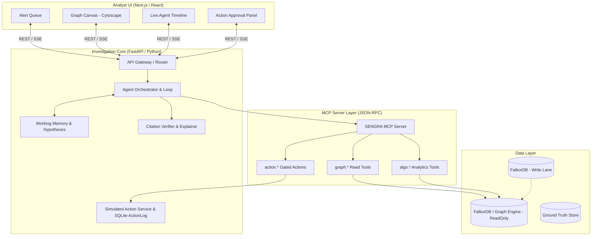

# harness.md — GraphSleuth (SENGRA)

> Single source of truth for GraphSleuth: Graph-Driven Investigation Agent for Financial Fraud Ring Investigation.
> Derived from `docs/raw.md`, `docs/Mcp.md`, `docs/Mcpguide.md`, and `docs/McpCheck.md`.

---

## 1. Problem Statement
Financial fraud rings, money mule networks, and coordinated attack structures hide inside complex relationship chains (shared devices, shared IP/phone/addresses, circular money flow). Traditional relational queries require rigid, expensive joins and miss multi-hop patterns, while vector-RAG lacks relational topology. 
GraphSleuth is an AI agent that navigates a connected property graph across 2–6 hops, dynamically selects graph query and algorithmic tools via MCP (Model Context Protocol), reasons about emergent ring structures, initiates gated remedial actions (flag, freeze, block), and produces fully verifiable, cited evidence subgraphs.
Full problem specification: [docs/raw.md](file:///D:/WorkSpace/Project/Agent/docs/raw.md).

---

## 2. Goals & Non-Goals

### Goals
1. Autonomous end-to-end alert investigation using multi-hop (2–6 hops) graph reasoning.
2. Expose graph queries (neighborhood, paths, shared attributes) and algorithms (Louvain community detection, PageRank centrality, cycle detection) as MCP tools.
3. Execute risk-tiered, reversible, auditable actions (flag entity, create case, freeze account, block device) with human-in-the-loop approvals.
4. Deliver 100% faithful explanations where every natural-language claim is strictly verified against an evidence subgraph.
5. Outperform non-graph baseline (Vector-RAG / SQL) by >= 25 percentage points on multi-hop detection accuracy.
6. Provide an analyst workbench UI: alert queue, graph canvas, live agent timeline, and approval actions.

### Non-Goals (v1)
- Real-time streaming ingestion at production tier-1 banking scale (focus on batch/generator dataset up to 50k accounts / 200k+ transactions).
- Real monetary ledger mutation (all financial actions target a simulated core banking action service).
- Multi-domain production deployment in v1 (Fraud Ring domain is primary; Security/Codebase domains remain pluggable architecture designs).
- Live unvetted external network access; all MCP servers run under strict sandboxing and parameter safety checks.

---

## 3. Users & Use Cases

### Personas
- **Fraud Analyst (Primary):** Investigates high-priority transaction alerts, visualizes ring topologies, reviews agent reasoning traces, and approves/rejects recommended account freezes.
- **Risk Team Lead:** Monitors the prioritized alert queue, tracks agent risk scores, calibrates false positive rates, and audits team actions.
- **Compliance Auditor:** Inspects verifiable case packages, tool-call audit logs, and counterfactual evidence trails.
- **Developer / MCP Integrator:** Adds new graph tools and data sources via standard MCP schemas without changing agent core logic.

### Key Use Cases
- **UC-1 Alert Triage:** Analyst opens alert A-1042; agent discovers shared device cluster with 9 accounts, runs community detection, computes risk, and queues freeze recommendation in < 60s.
- **UC-2 Interactive Graph Querying:** Analyst asks natural language questions ("Find shortest money flow path from A-1042 to known mule M-901"); agent executes pathfinding and renders subgraph.
- **UC-3 Human-in-the-Loop Approval:** Analyst reviews gated actions (account freeze, device block), inspects cited evidence E1–E3, and signs off with single-click audit logging.
- **UC-4 Audit & Case Export:** Auditor exports complete case file containing full tool execution trace, evidence citations, and officer approvals.

---

## 4. Requirements

| ID | Statement | Priority | Source |
|---|---|---|---|
| REQ-001 | Ingest synthetic and benchmark fraud datasets (accounts, devices, IPs, transactions, alerts) | MUST | raw.md §7.1 |
| REQ-002 | Store data in property graph schema with constraints, indexes, and derived TRANSFERRED_TO edges | MUST | raw.md §8 |
| REQ-003 | Seed ground-truth fraud patterns: mule chains, shared-device rings, and circular flows | MUST | raw.md §7.1 |
| REQ-004 | Expose graph query tools via MCP: get_entity, expand_neighborhood, shared_attributes | MUST | raw.md §7.2, Mcp.md |
| REQ-005 | Expose graph algorithm tools via MCP: find_paths, detect_communities, rank_centrality, detect_cycles | MUST | raw.md §7.2 |
| REQ-006 | Expose guarded Cypher tool (run_readonly_cypher) enforcing READ-ONLY, LIMIT, and timeout | MUST | raw.md §7.2, McpCheck.md |
| REQ-007 | Provide composite risk scoring tool (score_risk) with explainable factor breakdown | MUST | raw.md §7.2 |
| REQ-008 | Implement autonomous agent reasoning loop: plan -> select tool -> observe -> hypothesize -> verify | MUST | raw.md §7.3 |
| REQ-009 | Enforce strict budgets: max 15 tool calls, max 4 hops (expandable to 6), per-tool timeout (10s), loop breaker | MUST | raw.md §11 |
| REQ-010 | Implement write-back and simulated action tools: flag_entity, create_case, freeze_account, block_device | MUST | raw.md §7.4 |
| REQ-011 | Implement risk-tiered approval matrix (Low = Auto, Medium = 1-click, High = explicit review) | MUST | raw.md §13 |
| REQ-012 | Enforce action guardrails: reversible actions, idempotency, immutable ActionLog audit trail | MUST | raw.md §13 |
| REQ-013 | Implement faithful explanation engine: claims cite evidence IDs, verified against tool outputs | MUST | raw.md §14 |
| REQ-014 | Deliver Analyst Web UI: alert queue, graph canvas, live agent timeline, and approval panel | MUST | raw.md §17 |
| REQ-015 | Implement evaluation benchmark: detection precision/recall, multi-hop QA, and vector-RAG comparison | SHOULD | raw.md §19 |
| REQ-016 | Follow MCP standards: falkordb-readonly default, semgrep SAST, parameter binding verification | MUST | Mcp.md, Mcpguide.md |

---

## 5. Acceptance Criteria

- **AC-001-a (Ingestion & Schema):** Given raw CSV/synthetic transaction data, When the ingestion loader runs, Then all nodes (Account, Customer, Device, IP, Transaction, Alert) and relationships (OWNS, USED_DEVICE, USED_IP, SENT, RECEIVED_BY, TRANSFERRED_TO) are created with verified unique indexes.
- **AC-002-a (Ground Truth Seeding):** Given the hero scenario configuration, When test seeds are populated, Then at least one 9-account ring sharing 2 devices and 1 circular money cycle exists with separate evaluation ground-truth labels.
- **AC-003-a (MCP Tool Discovery):** Given an initialized MCP client session, When requesting tool catalog, Then all 15 tools (`graph.*`, `algo.*`, `action.*`) are returned with valid JSON schemas and read/write metadata.
- **AC-004-a (Neighborhood & Shared Attributes):** Given an alert on Account A-1042, When `expand_neighborhood(id='A-1042', hops=2)` and `shared_attributes(id='A-1042')` are executed, Then linked devices and co-located accounts are returned within <= 2s.
- **AC-005-a (Community & Cycle Detection):** Given a suspected mule cluster, When `detect_communities` and `detect_cycles` run on the subgraph, Then community IDs, membership lists, and circular transfer paths are output accurately.
- **AC-006-a (Guarded Cypher Execution):** Given a query containing write keywords (`CREATE`, `MERGE`, `DELETE`, `SET`), When sent to `run_readonly_cypher`, Then the query is rejected with a security violation error before execution.
- **AC-007-a (Agent Multi-Hop Reasoning & Budget):** Given an incoming alert, When the agent investigates, Then it makes <= 15 tool calls, maintains an evidence scratchpad, evaluates hypotheses across >= 2 hops, and terminates in < 60s.
- **AC-008-a (Risk Tiering & Approvals):** Given an investigation yielding risk score > 0.7 on high-risk accounts, When actions are generated, Then account freeze and device block are placed in `PENDING_APPROVAL` and never executed without recorded approver ID.
- **AC-009-a (Explanation Faithfulness):** Given the generated narrative rationale, When the citation verifier validates the report, Then 100% of cited evidence IDs map to verified entities/edges returned by tool outputs.
- **AC-010-a (Analyst UI Visualization):** Given an active investigation, When rendered in the browser, Then the Cytoscape graph canvas visualizes the evidence subgraph with highlighted rings and live streaming agent timeline.
- **AC-011-a (Harness & MCP Verification):** Given `python scripts/check_harness.py` and `mcpcheck` Part A/B checks, When executed, Then G0 passes with zero errors, zero literal secrets, and verified read-only database controls.

---

## 6. Architecture & Tech Stack



### Technology Selections
- **Graph Database:** FalkorDB (OpenCypher compliant, Redis-based graph module) with Python client / networkx fallback engine for deterministic offline CI runs.
- **MCP Server:** Python MCP SDK (`mcp` package) exposing JSON-RPC endpoints for `graph.*`, `algo.*`, and `action.*` tools.
- **Agent Orchestrator:** Python async engine with structured tool calling, step/token budget tracking, and loop prevention.
- **Backend API:** FastAPI (Python 3.14+) providing REST endpoints, Server-Sent Events (SSE) for timeline streaming, and SQLite audit log.
- **Frontend:** Next.js (TypeScript) / React with Cytoscape.js for interactive force-directed graph canvas, Tailwind CSS, and shadcn primitives.
- **Static Analysis & Security:** Semgrep (SAST, secret scanning), `check_harness.py`, `guard_paths.py`, and `breaker.py`.

---

## 7. Project Structure

```
.
├── AGENTS.md                         # Top-level index map (<= 150 lines)
├── CLAUDE.md                         # 3-line pointer to AGENTS.md
├── .mcp.json                         # Active MCP server configuration
├── docs/
│   ├── prompt.md                     # Harness master prompt operating manual
│   ├── raw.md                        # Product requirements & problem statement
│   ├── harness.md                    # This master plan
│   ├── Mcp.md                        # MCP server catalog and presets
│   ├── Mcpguide.md                   # MCP architectural policies & safety guide
│   ├── McpCheck.md                   # MCP verification checklist
│   ├── memory/                       # Semantic memory (interview, lessons, assumptions)
│   └── adr/                          # Architecture decision records
├── harness/
│   ├── profile.yaml                  # Project profile derived from raw.md
│   ├── agents/                       # Skinny agent pointers (<= 40 lines each)
│   ├── roles/                        # Fat role operating instructions
│   ├── standards/                    # Coding, testing, git, handoff contracts
│   ├── workflows/                    # Pipeline and sprint workflows
│   ├── tools/                        # registry.yaml, sandbox.md
│   ├── state/                        # state.json, state.schema.json, budgets.json, locks/
│   ├── tasks/                        # T-0001.md ... task definitions
│   ├── artifacts/                    # Per-task stage artifacts 01-spec ... 08-docs
│   └── logs/                         # session.log.md, events.jsonl, decisions.log.md
├── scripts/
│   ├── check_harness.py              # Deterministic harness linter
│   ├── guard_paths.py                # Lane and path ownership guard
│   └── breaker.py                    # Circuit breaker monitor
├── src/
│   ├── graph/                        # Graph connection, schema, Cypher queries, algorithms
│   ├── mcp/                          # MCP server implementation and tool definitions
│   ├── agent/                        # Agent loop, planning, memory, verifier
│   ├── actions/                      # Action service, approvals, ActionLog
│   ├── data/                         # Data generator, synthetic rings, benchmark loader
│   └── api/                          # FastAPI server endpoints
├── web/                              # Next.js frontend application
└── tests/
    ├── harness/                      # Unit tests for harness scripts
    ├── unit/                         # Unit tests for graph, tools, and agent
    └── integration/                  # End-to-end multi-hop investigation tests
```

---

## 8. Commands

| Purpose | Command |
|---|---|
| install | `pip install -e ".[dev]" && npm --prefix web install` |
| lint | `flake8 src tests && npm --prefix web run lint` |
| format | `black --check src tests && prettier --check "web/**/*.{ts,tsx}"` |
| typecheck | `mypy src tests && npm --prefix web run type-check` |
| unit test | `pytest tests/unit` |
| integration test | `pytest tests/integration` |
| build | `npm --prefix web run build` |
| harness self-test | `python scripts/check_harness.py && pytest tests/harness` |

---

## 9. Coding & Testing Standards

- **Code Style:** Python code adheres strictly to PEP 8, formatted with Black (line length 100), checked with Flake8 and Mypy strict mode. Frontend adheres to ESLint + Prettier.
- **Security & Parameter Binding:** Zero string-concatenated Cypher or SQL queries. All dynamic variables must be passed as parameterized query arguments (`$param`). Validated by `mcpcheck` rules P-01...P-10.
- **Test Pyramid:** 70% hermetic unit tests (< 1s per test), 20% integration tests against test graph fixtures, 10% end-to-end evaluation tests.
- **Coverage Floor:** Minimum 80% line coverage on changed code across all pull requests.
- **Mocking Rules:** External networks and LLM calls must have deterministic recorded mocks for CI test execution. Unit tests never execute live network requests.

---

## 10. Tools, APIs & MCP Servers

### MCP Server Inventory (`.mcp.json` - Preset: `sengra`)
1. `context7`: Up-to-date documentation on library APIs (FalkorDB, FastAPI, Next.js).
2. `falkordb-readonly`: Read-only OpenCypher query execution against graph store (default for agents).
3. `falkordb`: Write-capable graph database tool (restricted to Builder data lane, requires confirmation).
4. `sengra-mcp`: SENGRA domain tools (`graph.*`, `algo.*`, `action.*`).
5. `semgrep`: Local SAST security and secret scanner (`semgrep mcp`).
6. `playwright`: Headless browser automation for UI E2E verification.
7. `chrome-devtools`: Frontend performance and error diagnostics.

---

## 11. Autonomy & Approval Matrix

| Action | Kind | Autonomous? | Required Approval | Blast Radius Control |
|---|---|---|---|---|
| Read graph / entity query | Read | Yes (Auto) | None | Max 1000 nodes returned |
| Run graph algorithms | Analytic | Yes (Auto) | None | 10s execution timeout |
| Run read-only Cypher | Query | Yes (Auto) | None | Disallows mutation keywords, LIMIT enforced |
| Flag suspicious entity | Write | Yes (Auto) | None | Recorded in case with evidence IDs |
| Create investigation case | Write | Yes (Auto) | None | Audit log updated |
| Queue account freeze | Gated Action | **No** (Pending) | Fraud Analyst 1-click | Max 10 accounts per case |
| Queue device block | Gated Action | **No** (Pending) | Risk Lead Explicit Review | Verified device fingerprint match |
| External notification | Action | Yes (Auto) | None | Mock/simulated webhook |

---

## 12. Sprint Plan

| Sprint | Goal | Key Tasks | Exit Gate |
|---|---|---|---|
| **0 — Harness Scaffold** | Harness exists, self-tests pass, CI ready | Implement `check_harness.py`, `guard_paths.py`, `breaker.py`, `tests/harness/*`, config files, agent roles | `python scripts/check_harness.py` exits 0, `pytest tests/harness` passes |
| **1 — Walking Skeleton** | Thinnest end-to-end slice through pipeline | Synthetic generator (1 ring), local graph store, basic `expand_neighborhood` MCP tool, minimal agent loop returning verdict | All §9 gates pass, full artifact trail 01–08 in `harness/artifacts/T-0001/` |
| **2 — Core Graph Tools & MCP** | Full 15-tool MCP catalog & algorithms | Implement Louvain community detection, PageRank, cycle detection, guarded Cypher, tool contract tests | 100% tool schema validity, 15 tools pass unit tests |
| **3 — Multi-Hop Reasoning & Actions** | Autonomous investigation & gated actions | Agent hypothesis evaluation, working memory, risk-scoring tool, ActionLog, simulated freeze/block service | Hero case detected in < 60s, gated approvals logged |
| **4 — Explainability & Analyst UI** | Verifiable rationale & web interface | Citation verifier, Cytoscape graph canvas, live agent timeline, one-click action approval panel | 0 unverified claims, interactive canvas loads in < 2s |
| **5 — Evaluation & Hardening** | Rigorous evaluation & benchmark proof | Ground-truth benchmark evaluation (precision/recall >= 85%), vector-RAG comparison test, Semgrep scan | Benchmark report verified, zero security blockers |

---

## 13. Risks & Mitigations

| Risk | Impact | Mitigation |
|---|---|---|
| Agent infinite loop or tool thrashing | High latency, token waste | Step budget (<= 15 calls), duplicate tool-call detector, breaker trip |
| Hallucinated explanations / false citations | Loss of user trust, compliance breach | Citation verifier gate: all cited IDs must exist in tool output; reject on mismatch |
| Graph query injection via Cypher | Database compromise / unauthorized write | Parameterized Cypher queries; keyword ban on read-only queries; readonly DB user |
| Slow algorithm execution on large graph | Investigation timeout | Subgraph extraction prior to algorithm execution; 10s per-tool timeout |
| Accidental destructive action (account freeze) | Customer disruption | Strict human-in-the-loop approval tier for all account and device actions |

---

## 14. Assumptions

| ID | Statement | Date | Status |
|---|---|---|---|
| ASM-001 | Local development utilizes in-memory/embedded graph engine with FalkorDB OpenCypher compatibility for test autonomy. | 2026-10-18 | Validated |
| ASM-002 | Simulated core banking and mock notification services satisfy P0 action requirements without external banking APIs. | 2026-10-18 | Validated |
| ASM-003 | Python 3.14+ and Node.js v24+ available in the execution environment. | 2026-10-18 | Validated |
| ASM-004 | MCP tool discovery and execution will operate via JSON-RPC protocol standards conforming to `docs/Mcp.md`. | 2026-10-18 | Validated |

---

## 15. Open Questions

*(Empty — all architectural and functional ambiguities resolved through PRD and MCP specifications.)*

---

## 16. Definition of Done (Global Gates)

A task or sprint is strictly **Done** only when all criteria are verified:
- [ ] Artifacts `01` through `08` exist and valid handoff JSON files link each stage.
- [ ] G0 Harness integrity: `python scripts/check_harness.py` passes and `tests/harness/` pass.
- [ ] G1 Lane gate: code formatted, lint clean, type-checked, lane unit tests pass, no unparameterized queries.
- [ ] G2 Merge gate: full test suite passes with >= 80% coverage on changed lines.
- [ ] G3 Review & Security: 0 BLOCKER/MAJOR findings in review, 0 Semgrep vulnerabilities, 0 hardcoded secrets.
- [ ] G4 QA gate: integration tests pass, every acceptance criterion has test evidence, citation verifier clean.
- [ ] G5 Sprint gate: all sprint tasks completed, user demo passes, state and lessons updated.

---

## 17. Glossary

- **Cypher / OpenCypher:** Declarative graph query language for property graphs.
- **FalkorDB:** Low-latency graph database supporting OpenCypher queries.
- **MCP (Model Context Protocol):** Open protocol standardizing how applications provide context and tools to LLMs.
- **Multi-Hop Reasoning:** Traversing chains of relationships (e.g. Account -> Device -> IP -> Account) to infer indirect connections.
- **Mule Account:** Bank account used by criminals to receive and transfer illicit funds to obscure origins.
- **Evidence Subgraph:** The minimal subset of graph nodes and edges proving a specific hypothesis or claim.
