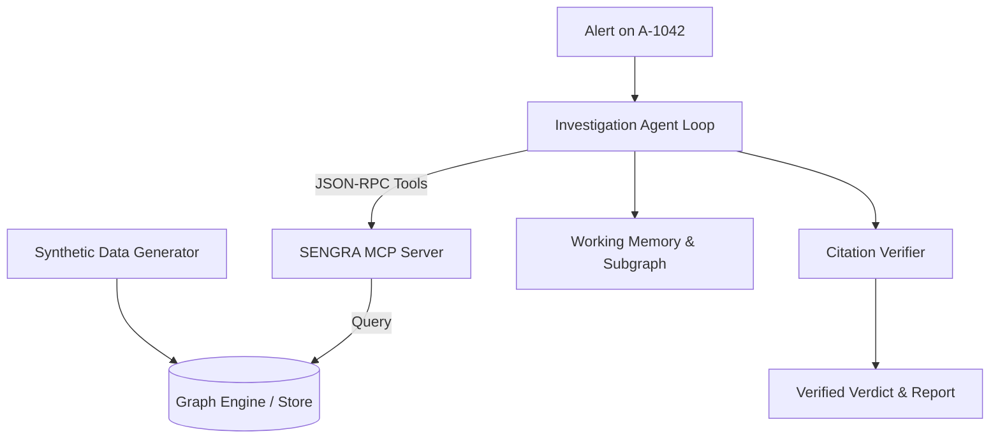

# 02-Design: Walking Skeleton Architecture & Interfaces

## 1. System Flowchart



## 2. Graph Data Model (T-0001 Subset)
- **Node Labels:**
  - `Account`: `{id: str, type: str, balance: float, flagged: bool, risk_score: float}`
  - `Device`: `{id: str, fingerprint: str, os: str}`
  - `Alert`: `{id: str, account_id: str, rule: str, severity: str, created_at: str}`
- **Relationship Types:**
  - `(:Account)-[:USED_DEVICE]->(:Device)`
  - `(:Account)-[:TRANSFERRED_TO {amount: float, ts: str}]->(:Account)`

## 3. MCP Tool Interface Designs

### 3.1 `graph.get_entity`
- **Purpose:** Fetches node properties and labels by unique identifier.
- **Input Schema:**
  ```json
  {
    "type": "object",
    "required": ["entity_id"],
    "properties": {
      "entity_id": { "type": "string", "description": "Unique ID of the entity" }
    }
  }
  ```
- **Output:** Node dictionary `{id, labels, properties}` or null.

### 3.2 `graph.expand_neighborhood`
- **Purpose:** Traverses relationships up to `max_hops` away from target entity.
- **Input Schema:**
  ```json
  {
    "type": "object",
    "required": ["entity_id"],
    "properties": {
      "entity_id": { "type": "string" },
      "hops": { "type": "integer", "default": 2, "maximum": 4 },
      "limit": { "type": "integer", "default": 50 }
    }
  }
  ```
- **Output:** `{nodes: [...], edges: [...]}`

## 4. Agent Loop & Citation Verifier
- **Loop Strategy:**
  1. Receive alert target `A-1042`.
  2. Call `get_entity(entity_id="A-1042")` to inspect account status.
  3. Call `expand_neighborhood(entity_id="A-1042", hops=2)` to inspect devices and linked accounts.
  4. Aggregate discovered nodes into working memory.
  5. Formulate hypothesis: If shared device connects to accounts with outgoing transfers, flag ring pattern.
  6. Generate structured verdict citing evidence keys `[E1, E2]`.
- **Citation Verifier:**
  - Extract all cited IDs in the rationale text matching `E\d+` or `A-\d+|D-\d+`.
  - Validate that every extracted entity ID exists in the tool call outputs. Mismatches cause rejection.
