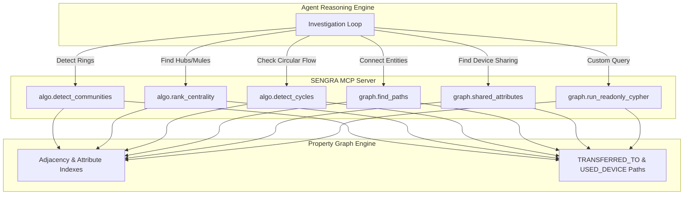

# 02-Design: Core Graph Algorithms & MCP Tool Contracts

## 1. Algorithmic Workflow & Tool Topology



## 2. Tool Input & Output Schemas

### 2.1 `algo.detect_communities`
- **Input:**
  ```json
  {
    "type": "object",
    "properties": {
      "subgraph_nodes": { "type": "array", "items": { "type": "string" }, "description": "Optional list of node IDs to restrict scope" }
    }
  }
  ```
- **Output:**
  `{"communities": [{"community_id": 1, "members": ["A-1042", "A-1050", "D-77", "A-1061"], "size": 4}]}`

### 2.2 `algo.rank_centrality`
- **Input:**
  ```json
  {
    "type": "object",
    "properties": {
      "subgraph_nodes": { "type": "array", "items": { "type": "string" } },
      "damping_factor": { "type": "number", "default": 0.85 },
      "max_iterations": { "type": "integer", "default": 20 },
      "top_k": { "type": "integer", "default": 10 }
    }
  }
  ```
- **Output:**
  `{"rankings": [{"id": "A-1050", "score": 0.34}, {"id": "A-1042", "score": 0.28}, ...]}`

### 2.3 `algo.detect_cycles`
- **Input:**
  ```json
  {
    "type": "object",
    "properties": {
      "start_node": { "type": "string", "description": "Optional starting node to trace cycles from" },
      "min_length": { "type": "integer", "default": 3 },
      "max_length": { "type": "integer", "default": 6 }
    }
  }
  ```
- **Output:**
  `{"cycles": [{"path": ["A-1042", "A-1050", "A-1061", "A-1042"], "length": 3, "total_amount": 8700.0}]}`

### 2.4 `graph.find_paths`
- **Input:**
  ```json
  {
    "type": "object",
    "required": ["source_id", "target_id"],
    "properties": {
      "source_id": { "type": "string" },
      "target_id": { "type": "string" },
      "max_hops": { "type": "integer", "default": 4 }
    }
  }
  ```
- **Output:**
  `{"shortest_path": ["A-1042", "A-1050", "A-1061"], "hops": 2, "edges": [...]}`

### 2.5 `graph.shared_attributes`
- **Input:**
  ```json
  {
    "type": "object",
    "required": ["entity_id"],
    "properties": {
      "entity_id": { "type": "string" },
      "attribute_type": { "type": "string", "default": "Device" }
    }
  }
  ```
- **Output:**
  `{"shared_entities": [{"attribute_id": "D-77", "attribute_type": "Device", "linked_entities": ["A-1042", "A-1050"]}]}`

### 2.6 `graph.run_readonly_cypher`
- **Input:**
  ```json
  {
    "type": "object",
    "required": ["query"],
    "properties": {
      "query": { "type": "string" },
      "params": { "type": "object", "default": {} }
    }
  }
  ```
- **Output:**
  `{"rows": [...]}` (Throws error if query contains `CREATE`, `MERGE`, `DELETE`, `SET`, etc.)
