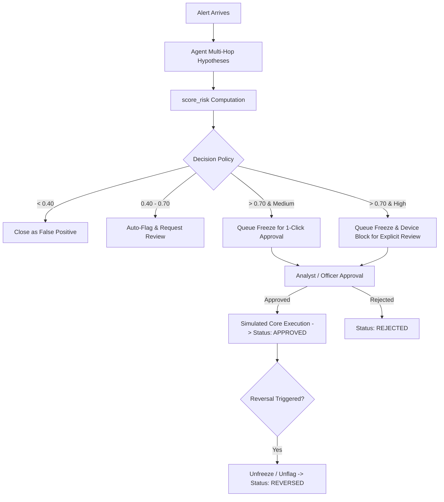

# 02-Design: Multi-Hop Reasoning & Action Layer

## 1. Action Decision Policy & Approval Flow



## 2. Risk Scoring Formula (`algo.score_risk`)
- **Formula:**
  $$\text{Risk} = 0.35 \times S_{\text{device}} + 0.30 \times S_{\text{cycle}} + 0.20 \times S_{\text{community}} + 0.15 \times S_{\text{velocity}}$$
  - $S_{\text{device}}$: 1.0 if sharing device with flagged/multiple accounts; 0.0 otherwise.
  - $S_{\text{cycle}}$: 1.0 if participant in circular money loop; 0.0 otherwise.
  - $S_{\text{community}}$: Density ratio of internal transfers in community cluster [0.0, 1.0].
  - $S_{\text{velocity}}$: Account transaction velocity factor [0.0, 1.0].
- **Output Structure:**
  ```json
  {
    "account_id": "A-1042",
    "risk_score": 0.88,
    "tier": "HIGH",
    "factors": [
      { "name": "shared_device", "weight": 0.35, "value": 1.0, "contribution": 0.35 },
      { "name": "circular_flow", "weight": 0.30, "value": 1.0, "contribution": 0.30 },
      { "name": "community_density", "weight": 0.20, "value": 0.71, "contribution": 0.14 },
      { "name": "high_velocity", "weight": 0.15, "value": 0.60, "contribution": 0.09 }
    ]
  }
  ```

## 3. Simulated Action Service Data Model
- **`ActionRecord`:**
  - `action_id`: Unique string (e.g. `ACT-1001`).
  - `case_id`: String (e.g. `CASE-2026-01`).
  - `action_type`: `FLAG_ENTITY` | `CREATE_CASE` | `FREEZE_ACCOUNT` | `BLOCK_DEVICE` | `NOTIFY_ANALYST`
  - `target_id`: Entity being affected (e.g. `A-1042` or `D-77`).
  - `status`: `AUTO_EXECUTED` | `PENDING_APPROVAL` | `APPROVED` | `REJECTED` | `REVERSED`
  - `reason`: Plain-text rationale.
  - `evidence_ids`: List of cited evidence IDs (`["E1", "E2"]`).
  - `approver`: Officer ID or `SYSTEM`.
  - `timestamp`: ISO-8601 string.
  - `idempotency_key`: Client-supplied deduplication key.
- **Reversibility Actions:**
  - `unfreeze_account(account_id, reason)` -> Updates state and logs reversal.
  - `unflag_entity(entity_id, reason)` -> Updates state and logs reversal.

## 4. MCP Action Tool Interfaces
1. `action.flag_entity(case_id, entity_id, reason, evidence_ids)` -> Returns action record.
2. `action.create_case(title, entity_ids, summary)` -> Returns case ID.
3. `action.freeze_account(case_id, account_id, reason, evidence_ids)` -> Returns `PENDING_APPROVAL`.
4. `action.block_device(case_id, device_id, reason, evidence_ids)` -> Returns `PENDING_APPROVAL`.
5. `action.approve_action(action_id, approver_id)` -> Executes action.
6. `action.reverse_action(action_id, reason, approver_id)` -> Reverses action.
