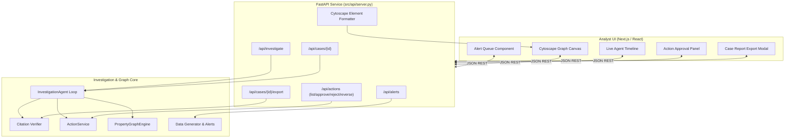

# 02-Design: Explainability & Analyst UI Architecture

## 1. System Architecture



## 2. API Contract Specification

### `GET /api/alerts`
- Returns array of alerts:
```json
[
  {
    "id": "ALT-1001",
    "account_id": "A-1042",
    "rule": "VELOCITY_SPIKE_SHARED_DEVICE",
    "severity": "CRITICAL",
    "created_at": "2026-10-18T10:00:00Z",
    "status": "NEW"
  }
]
```

### `POST /api/investigate`
- Request: `{"account_id": "A-1042", "alert_id": "ALT-1001"}`
- Response: Case object containing:
  - `case_id`: String (e.g. `CASE-A1042`)
  - `verdict`: "FRAUD_RING_DETECTED"
  - `risk_score`: 0.85
  - `rationale`: Natural language narrative citing evidence tokens
  - `hypotheses_tested`: Evaluated hypotheses with status
  - `timeline`: Array of step traces (tool, input, output, duration)
  - `elements`: Cytoscape-formatted nodes and edges with `is_ring` highlights
  - `recommended_actions`: Actions proposed or queued

### `POST /api/actions/{action_id}/approve`
- Request: `{"approver": "lead_analyst_sarah"}`
- Response: Updated action object with status `COMPLETED`.

### `GET /api/cases/{case_id}/export`
- Response: Plaintext / Markdown report containing header, summary, citations, timeline, and audit log.

## 3. Cytoscape Graph Canvas Design
- Node Types & Styling:
  - `Account`: Circular node, Navy `#1e293b`. Flagged / Ring accounts styled in Crimson `#ef4444` with glowing border.
  - `Device`: Hexagonal node, Indigo `#6366f1`.
  - `Customer`: Square node, Slate `#64748b`.
  - `Transaction`: Directed edges with edge labels indicating transfer amount and currency.
- Ring Highlighting: Nodes and edges participating in cycles or shared device collusion receive `is_ring: true` and accented styling.
- Layout: Force-directed `cose` algorithm with layout animation under 1.5s.

## 4. One-Click Action Approval Panel Design
- Table listing pending remediation actions:
  - Target Account / Device
  - Action Type (`FREEZE_ACCOUNT`, `BLOCK_DEVICE`)
  - Risk Level & Reason
  - Citing Case ID & Evidence Tokens
  - Actions: Green [Approve] button and Red [Reject] button.
  - History tab displaying executed, rejected, and reversed actions with approver names.
