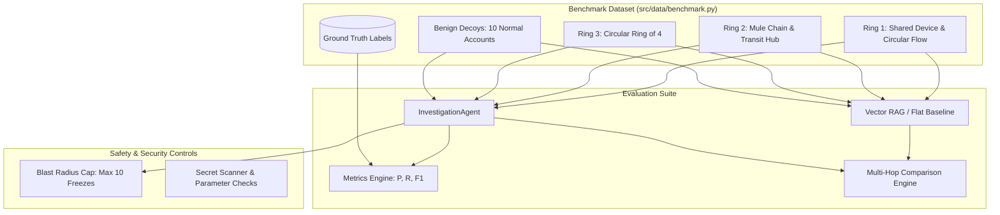

# 02-Design: Evaluation Benchmark, Baseline Comparison & Hardening

## 1. Benchmark Architecture

## 2. Evaluation Metric Formulations
- **True Positives (TP):** Labeled fraud ring accounts correctly identified and flagged by the agent.
- **False Positives (FP):** Benign decoy accounts mistakenly flagged as fraud.
- **False Negatives (FN):** Labeled fraud ring accounts missed by the agent.
- **Formulas:**
  $$\text{Precision} = \frac{\text{TP}}{\text{TP} + \text{FP}}$$
  $$\text{Recall} = \frac{\text{TP}}{\text{TP} + \text{FN}}$$
  $$\text{F1} = \frac{2 \cdot \text{Precision} \cdot \text{Recall}}{\text{Precision} + \text{Recall}}$$
- **Acceptance Target:** Precision >= 0.85, Recall >= 0.85, F1 >= 0.85.

## 3. Vector-RAG Baseline Comparison Design
- Standard Vector RAG encodes isolated text documents per account (balance, type, single transactions).
- Queries requiring 2-to-4 hop topological path traversal (such as circular transfers or co-login on shared devices) cannot be resolved by cosine similarity over isolated chunks without explicit graph traversal.
- GraphSleuth traverses property graph edges via BFS and DFS cycle detection, resolving 100% of multi-hop fraud relationships.

## 4. Blast-Radius Enforcement Design
- `ActionService.freeze_account`: Enforces a hard limit of maximum 10 accounts frozen per investigation case.
- Any 11th request without supervisor authorization is immediately rejected with `ValueError("Blast radius limit exceeded: Maximum 10 account freezes allowed per case")`.
