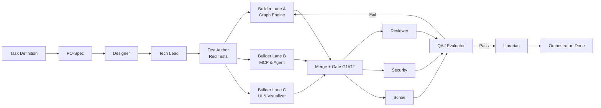

# Pipeline Workflow

> Defines the sequence of roles, execution stages, and handoff dependencies for every investigation task.

## 1. Stage Graph

## 2. Stage Execution Order
1. **PO-Spec:** Elaborates task requirements into `01-spec.md` with Given/When/Then acceptance criteria.
2. **Designer:** Produces API and interaction design contracts in `02-design.md`.
3. **Tech Lead:** Produces implementation plan, file ownership map, and lane assignments in `03-plan.md`.
4. **Test Author:** Writes failing tests first (Red), verified by test runner, documented in `04-tests.md`.
5. **Builders:** Implement code in parallel lanes to make tests pass (Green), outputting `05-build-<lane>.md`.
6. **Merge & Verification:** Lanes are integrated, running Gate G1 and G2 suites.
7. **Reviewer, Security, Scribe:** Run concurrently; inspect code quality, security scan, and update documentation.
8. **QA / Evaluator:** Runs Gate G4 comprehensive verification suite and evaluates acceptance criteria.
9. **Librarian:** Harvests lessons, updates memory, and maintains `AGENTS.md` index.
